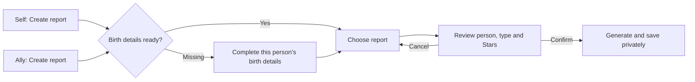

# Report entry from Self and Allies

## User outcome

Start a report with one visible action from Self or any Ally. Starting reveals choices and costs; it does not order or generate a report. A prior report must never remove the action to create another.

Operate-mode refinement of existing Astra styling. Preserve the gold primary treatment, typography, private person ownership, saved reports, report types and deliberate priced confirmation.

## Interaction

The selected Ally remains the same person when birth details are missing. This is not Add Ally. Complete data opens report choices immediately. Unknown time remains supported where eligible; Life Chapter explains its known-time requirement. Edit birth details stays available inside the task. Back/cancel and errors preserve a clear route to the originating tab.

## Evidence and patterns

The old Ally card replaced Create with an icon-only View action after a saved report. Its no-chart link went to Add Ally. Self's mount key ignored the requested step. Oversized populated Allies introductory content hid the actual task below the first screen.

Mobbin's [Apollo report creation flow](https://mobbin.com/flows/f7d29a45-03fa-4a10-af77-0892be3d449c) visibly separates Create report, configuration, and an explicit Save report. Borrow that action hierarchy, not its analytics dashboard or visual identity. The [Deputy flow](https://mobbin.com/flows/5e01b3be-9c08-4675-ba6c-4c4606b85e28) also retains a visible Create report action alongside existing reports. Reviewed actual returned screen previews.

Local pattern acceptance: `05-progressive-disclosure.md` (ask for birth details only when needed), `19-intentional-friction.md` (keep cost confirmation), and `23-deep-link.md` (selected person and requested step survive navigation). No urgency, automatic purchase, duplicate-person creation, hidden sharing, or changed report generation policy.

Analytics: N/A for runtime emission; this app currently has no analytics transport. A future `report_started` event should follow the existing event contract with surface, pattern, user_state, device, source and result, excluding personal/birth data. No new analytics dependency is introduced.

## Validation

Verify signed-out gates; Self with/without birth data; Ally with a saved report, without a report, and without a chart; unknown birth time; changing birth details; report selection and cancelling priced confirmation; loading/disabled controls; recoverable field errors; keyboard focus; and 390/820/1440 layouts. No paid generation in UI testing. Test data belongs to fictional accounts in the isolated alpha database, never Tony's existing account.

Implementation and final QA evidence are recorded in the private local `.astra-exports/report-entry-2026-10-22/` directory. The public-facing alpha is the review destination; the production apex is outside this change.

## Implementation review

The changed paths implement the acceptance criteria directly: Self resets its requested step and skips unrelated arrival setup for an explicit report request; Allies exposes persistent report actions and binds incomplete setup to an owned Ally; the shared panel retains the person, permits birth-detail correction, explains invalid report selections, and preserves priced confirmation. Compact Allies layout removes the redundant illustration and its unused styles. Styling and copy remain in the existing CSS/i18n system.

Static validation: typecheck, i18n check, production build, focused birth-date and report-basis checks passed. Repository lint passes with ignored private experiment exports excluded; one pre-existing unused-variable warning remains in an unrelated repair script. Mechanical design review found only the existing Inter font choice, retained as the approved product typography. Rendered review by the UI designer accepted the changed journey. Desktop/tablet/phone click-through found no page errors, horizontal overflow or report writes.
