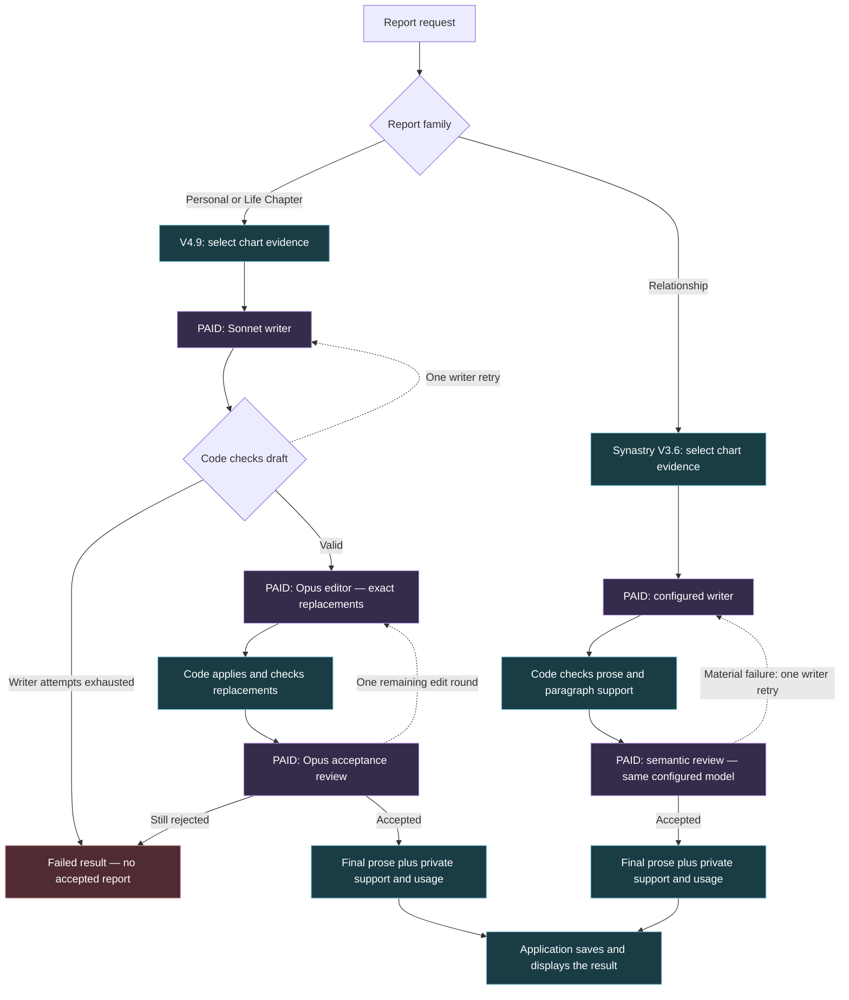
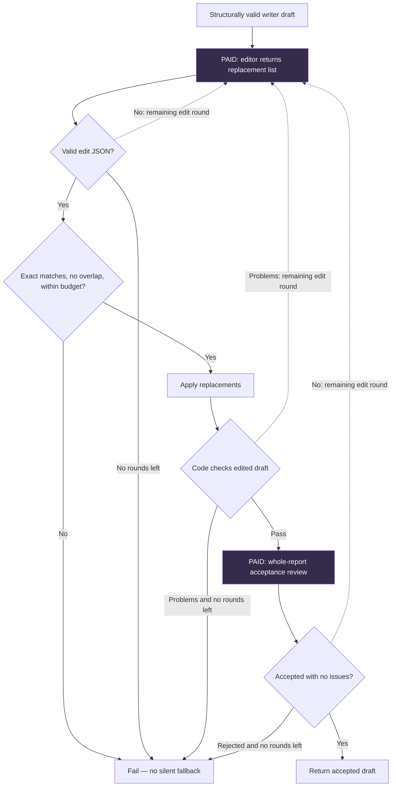

# AstraComposer — current report-writing flow

Verified September 19, 2026 against the existing portraits worktree. This describes current local implementation, not deployed production. No model calls were made to prepare this document.

**Personal and Life Chapter still have a paid editor. Synastry does not.** The recent removal applied only to Synastry.

## The linked boxes

Solid arrows show the ordinary path. Dotted arrows show bounded retries. Model calls are labeled **paid**; other boxes are ordinary code. Click a source-linked box where the Markdown viewer supports Mermaid links; the source links below work independently.

The overview shows the main paths. The exact V4 edit loop and less common failure cases are below. Private test harnesses save local artifacts instead of writing application reports.

## Personal and Life Chapter: what each step does

| Step | Current behavior | Model call? |
| --- | --- | --- |
| Select evidence | Assemble facts and meanings for this person and report type. Life Chapter includes its selected progression date. | No |
| Write | Produce a structured draft: connecting idea, section titles, prose and private evidence references. Current standard writer is Sonnet 4.6; configuration can select the writer. | Yes |
| Check draft | Validate structure, known evidence references, 650–2,200 words, paragraphs, duplicate content and private-data leakage. No paragraph-start quota. These checks do not establish literary quality; the separate meaning/source review remains. | No |
| Edit | Opus 4.8 returns exact source spans, replacements and reasons. It can return zero edits. It does not reprint the whole report. | Yes |
| Apply edits | Require each source span to match exactly once; reject overlaps and excessive revision. Preserve headings and support references. | No |
| Review | A separate Opus 4.8 call decides whether the whole candidate is acceptable and lists material defects. This is a separate call, not a different model from the editor. | Yes |
| Return result | Produce final sections, private evidence/support, review history and combined usage. The caller handles persistence. | No |

**The V4 editor still has a substantive brief.** It can address material errors, repetitive conclusions and high-impact prose habits. The light-touch Synastry brief was never applied to Personal or Life Chapter.

## The actual V4 edit loop

The limits are explicit:

- At most **two writer attempts**. A retry addresses invalid draft structure or failed local draft checks.
- At most **two edit rounds** after a valid draft. Invalid edit JSON consumes a round. Review rejection or edited-draft check failures can use the remaining round.
- At most **12 replacements per edit response**, with a **cumulative 25% word-revision allowance** across edit rounds. This is a ceiling, not a target.
- Ordinary successful run: **three paid calls**. The longest successful bounded path can use **six**: two writer calls, two editor calls and two reviews.
- Zero edits still incurs the editor call and then the acceptance-review call.
- Truncated model output, invalid/ambiguous replacements, overlap, exceeded edit allowance, provider exceptions or malformed review JSON fail the run. They do not start an unbounded repair loop or silently return unaccepted prose.
- Exhausting editing does **not** restart the whole writer. The outer writer retry is for draft problems before editing.

## Synastry: the editor is gone

The current Synastry version is **V3.6**, alongside the **V4.9** Personal/Life Chapter engine. “V4 reports” is therefore an umbrella description, not one identical pipeline.

- The writer produces prose and paragraph-level private support.
- A Lover request invites romantic exploration. Writer and reviewer share the same possibility-language guidance: describe an unconfirmed response with natural “can,” “may,” or conditional framing, without hedging every sentence. This changes no stages or call counts.
- Code checks that output, then a semantic-review call assesses support for its claims.
- Ordinary success uses **two paid calls**. On the current standard OpenRouter route, both use Sonnet 4.6. The legacy OpenAI route uses its configured model.
- Invalid writer output or material semantic failure can trigger one corrective writer attempt. Persistent failure returns a failed report.
- The semantic reviewer has its existing bounded retry. If it remains unavailable, an otherwise deterministically accepted report can complete with a private unavailable-review note; that is not a completed semantic endorsement.
- Existing automatic phrase substitutions still run during section parsing. They are ordinary code, not a paid editor.
- Old reports may retain historical editor metadata. New Synastry reports do not create it.

## What this means for cost

Removing the Synastry editor removes that paid stage and its full prose/support regeneration. It does not establish a fixed savings percentage for future reports. Personal and Life Chapter still pay for both editing and acceptance review, including when the editor makes no changes.

Reading grade is a diagnostic, not proof that a model call improved the reading. To judge editorial value, compare **writer draft → raw editor output → final rendered prose**, keeping model edits separate from automatic substitutions.

## Source links

- [V4 writer, editor, checks and retry loops](../../packages/astrology/src/report/portraitsV4.ts)
- [Model dispatch, evidence selection, Synastry orchestration and phrase normalization](../../packages/astrology/src/index.ts)
- [Current Synastry writer and semantic-review prompts](../../packages/astrology/src/report/synastryV3.ts)
- [Removal decision and verification](../evaluations/SYNASTRY_EDITOR_REMOVAL_V3_5.md)
- [V3.6: romantic potential and natural uncertainty](../evaluations/SYNASTRY_POTENTIAL_V3_6.md)
- [V4 checks and current verification guidance](../../akashic/playbooks/astra-verification-tiers.md)
- [Measured quality/cost review and proposed simplification](../evaluations/REPORT_QUALITY_COST_REVIEW_2026_09_19.md)
- [Writing research: papers, limitations and implications for Astra](../evaluations/LLM_WRITING_RESEARCH_2026_09_19.md)
- [New simplification tests and the fewer-style-rules standard](../evaluations/REPORT_SIMPLIFICATION_TESTS_2026_09_19.md)

Verified against implementation after the Synastry editor removal. This document changes no generation behavior and authorizes no deployment or further spending.
