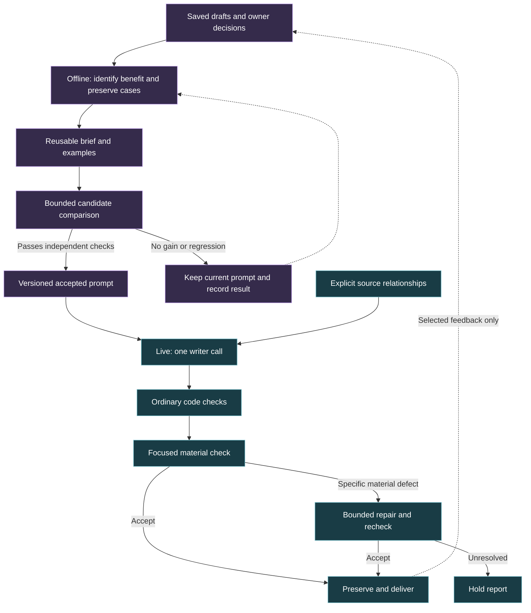

# LLM writing research: techniques worth testing in AstraComposer

Research date: September 19, 2026. Primary papers, with particular attention to methods, evaluation and limitations. This is a focused technical review, not an exhaustive systematic review. Publication year and model generation matter: a result using GPT-4o or a fine-tuned small model is not a measurement of today's Astra writer.

Follow-up: [three local tests and the next supported simplification](REPORT_SIMPLIFICATION_TESTS_2026_09_19.md). Explicit source fields did not improve the missed relation case. The paragraph-start quota rejected two readings that passed the existing material check. Preserve this negative evidence alongside the papers.

## Recommendation

**The most useful new quality direction is an example-based writing brief, refined offline against stable reader preferences.** Build it from passages worth preserving and specific improvements that earned their changes. Reuse that brief in the existing writer call. Evaluate source relationships separately, and permit repair only for an identified defect.

This combines three research directions without adding a new live agent: an evidence-backed style sheet, contrastive examples, and measured prompt optimization. It would turn Tony's feedback into reusable training material for the prompt. It would not fine-tune model weights or require an optimizer to run for every customer.

Tony's clarification governs any writing brief: **fewer formal style rules; the report needs to make sense, not follow a fixed mold.** Examples should demonstrate a range of effective writing and actual reader benefits. Do not convert them into paragraph quotas, phrase bans, mandatory sentence patterns or a reading-grade target that overrides meaning.

The immediate cost recommendation remains [bypassing compulsory V4 editing on accepted drafts](REPORT_QUALITY_COST_REVIEW_2026_09_19.md). Test that independently from changing the writer prompt. Today's $0.67 checker bakeoff also remains decisive local evidence: reasoning-off and cheaper models missed a complete-report source error. Literature does not override that result.

## The papers that change the direction

### 1. Improve prompts from recorded outcomes

**GEPA — Reflective Prompt Evolution Can Outperform Reinforcement Learning** (2025 preprint; current paper accepted at ICLR 2026) evolves prompts using execution feedback, tests candidates under a rollout budget, and retains alternatives that perform well on different cases. Model weights remain fixed. Its six principal benchmarks concern math, question answering, instruction following, verification and privacy—not literary portrait quality. Its large reported efficiency gains should not be imported into an Astra forecast. [Paper, especially sections 2–4](https://arxiv.org/abs/2507.19457)

**Learning from Contrastive Prompts** (Findings of ACL 2026) compares successful and unsuccessful prompts rather than learning only from errors. The reported experiments use Big-Bench Hard, with 50 training and 200 test examples per task and up to 50 optimization iterations. It is evidence for contrastive prompt search on those tasks, not evidence that such a search writes better reports. [Paper](https://aclanthology.org/2026.findings-acl.9/)

**Astra application — inference:** keep a compact record of why a version improved or regressed, then propose a bounded prompt change and replay it. Include preservation cases so the optimization cannot earn points by changing everything. Use a held-out evaluation set even where a paper's experimental selection procedure did not require one. Start with the method; install GEPA only if manual candidate management becomes the actual bottleneck.

This directly addresses the lack of cumulative learning. An archive becomes useful feedback when future candidates must beat its decisions. Repeated self-approval provides no equivalent learning signal.

### 2. Compile a writing style from evidence

**Whose story is it? Personalizing story generation by inferring author styles** (IJCNLP-AACL 2025) constructs an Author Writing Sheet from claim–evidence pairs in prior work, then uses it during generation. The human subset covered 45 author stories and 135 comparison pairs. The sheet won 56% against 27% for the baseline, with ties making up the rest; agreement was only fair. The headline 78% result is from automated evaluation, not that human comparison. [Paper, sections 3 and 7](https://aclanthology.org/2025.ijcnlp-long.82/)

**Improving RAG for Personalization with Author Features and Contrastive Examples** (2025 preprint) adds author features and examples from contrasting writers. Its tasks were titles and tweet paraphrases, with a 128-token generation ceiling. Some feature combinations helped ROUGE; adding more contrasting authors could hurt. This supports selective exemplars, with substantial limits on transfer to whole reports. [Paper, sections 3–4](https://arxiv.org/abs/2504.08745)

**Astra application — inference:** distill the existing adult, plainspoken voice into a short reusable card, with evidence for each instruction. Pair a confusing passage with the smallest beneficial repair, and include a good passage whose correct treatment is to preserve it. Teach relationships between ideas, degree of directness and rhythm. Keep subject facts out of style exemplars so one person's biography or chart cannot leak into another report.

Astra already contains voice and idea-economy instructions. The proposed change is concrete exemplars and measured reuse of feedback, not another list of similar instructions. A static curated card can fit the present API; a retrieval service is unnecessary at this scale.

### 3. Address the grammar of generic prose

**Do LLMs write like humans? Variation in grammatical and rhetorical styles** (PNAS 2025) compares continuations from six GPT-4o/Llama 3 variants with human text across genres. Each corpus began with 12,000 human texts; the study measures 66 linguistic features. Instruction-tuned models showed a distinctive information-dense, noun-heavy style even when given human examples to continue. This is a broad style diagnosis, not proof that a fixed list of prohibited constructions improves writing. [Paper, Materials and Methods and Results](https://www.pnas.org/doi/10.1073/pnas.2422455122)

**Astra application — inference:** look for piled-up abstractions, several mechanisms compressed into one sentence, and repetitive explanatory structure. Model a clearer alternative with an actor, an ordinary verb and one useful consequence. Track distributions across a report, not quotas per sentence. Do not prohibit every nominalization, participle or long sentence. The target is a reading experience, not evasion of an AI detector.

This is more specific than telling a writer to sound human or lowering the reading grade. It also explains why replacing isolated words often leaves the burden of a passage unchanged.

### 4. Explore alternative ideas before drafting

**Verbalized Sampling** (2025 preprint, revised July 2026) asks for several candidates with stated probabilities. It reports increased diversity in poems, stories and jokes. A 90-annotator human study found comparable quality with greater diversity. Extra computation and imperfect probability calibration remain limitations. [Paper, sections 4–5 and limitations](https://arxiv.org/abs/2510.01171)

**Astra application — inference:** if repetitive ideas remain, test a few evidence-supported chapter approaches inside the existing planning allowance, then draft one report. Compare ordinary candidate planning with verbalized sampling under the same token budget. These probabilities cannot establish that an interpretation is true.

This is a later experiment. Generating several complete reports would add cost and machinery. Novelty alone is not success.

### 5. Localize the defect before editing

**Reducing Sequence Length by Predicting Edit Spans with Large Language Models** (EMNLP 2023) trains models to output positions and replacement text for local transformations, including grammar correction and formality transfer. It reduces generated sequence length while retaining task performance in its studied settings. It is a trained editing method, not a benchmark of a few-shot prompt on Opus. [Paper](https://aclanthology.org/2023.emnlp-main.619/)

**Astra application — inference:** V4 already uses exact replacement spans, so that part is not new work to add. The missing economy is deciding whether a repair is needed before invoking it. A finding should identify the passage, the defect and the reader benefit. No finding should mean unchanged prose and no repair call. Count gratuitous edits as failures, including fluent but unnecessary rewrites.

The complementary older [where-to-edit research](https://aclanthology.org/2022.emnlp-main.678/) explicitly separates edit location and intent from the revision operation. The useful principle is selective scope; importing its whole iterative system would be unnecessary here.

### 6. Verify the relationship between facts

**Localizing Factual Inconsistencies in Attributable Text Generation / QASemConsistency** (TACL 2026) represents small predicate–argument relations as question–answer pairs and checks each against trusted reference text. The dataset has over 3,000 instances. A crucial limitation is failure to capture some implicit and inter-sentence discourse relations, including changed cause and consequence. [Paper, sections 3–5 and 7](https://aclanthology.org/2026.tacl-1.6/)

**Merging Facts, Crafting Fallacies / D-FActScore** (Findings of ACL 2024) demonstrates that individually verified facts can form a false paragraph when facts about distinct people with ambiguous names are merged. Ordinary atomic factuality and citation metrics can overestimate correctness. Its experiments concern biographies; the analogous Astra risk is mixing distinct chart entities. [Paper](https://aclanthology.org/2024.findings-acl.160/)

**Astra application — inference:** ask which exact entity participates in the relationship. For the observed source error, distinguish natal Mars from progressed Mars before using either sign or house. For an emotional assertion, distinguish a possible response from a claim about the other person's actual feelings. Preserve enough surrounding text to check negation, possibility and causal implications.

This is the strongest semantic direction for the observed defect. A small source tuple and a focused comparison may make the task easier, but that must be demonstrated. Correct individual IDs do not establish a correct whole paragraph. A semantic parser or entailment model cannot yet replace the complete contextual check on this evidence.

### 7. Build a judge around the intended reader

**LitBench** (2025 preprint) evaluates creative-writing judgments on 2,480 held-out story pairs and trains reward models on 43,827 pairs. Labels come from filtered Reddit preferences, with steps to reduce exposure and length bias. Its best tested off-the-shelf judge agreed with labels about 73% of the time; trained judges reached about 78%. Reddit preference is a proxy, and the authors acknowledge remaining confounds. [Paper, dataset construction and limitations](https://arxiv.org/abs/2507.00769)

**CoKe: Customizable Fine-Grained Story Evaluation via Chain-of-Keyword Rationalization** (GEM workshop 2025) uses compact evaluative keywords with trained small models to predict story-aspect ratings. It challenges the assumption that fluent explanations improve scoring. Most experiments predate early 2024, and the authors explicitly did not test newer large reasoning models. [Paper, sections 4 and Limitations](https://aclanthology.org/2025.gem-1.31/)

**WritingBench** (2025, revised November) evaluates six writing domains with task-specific criteria and a trained critic. Its human validation includes 300 queries and five trained annotators. A creative-content ablation reports a small benefit from chain-of-thought in the tested model; therefore the literature does not support a universal rule that reasoning harms writing. Critic scores are still task- and evaluator-dependent. [Paper, section 4.3 and appendix A.2](https://arxiv.org/abs/2503.05244)

**Astra application — inference:** use anonymized A/B/tie comparisons anchored to the reader's task. Check retained insight, adult tone, distinct chapter contribution and useful specificity. Record a short reason, not a long scoring essay. Keep false factual implications as a separate constraint. Model judgments should be calibrated against owner decisions before they can select winners automatically.

A small trained critic might eventually be economical at volume. These papers do not make an untrained cheap checker a reliable literary judge. Today's Haiku test reinforces that boundary.

## Two important cautions from the same literature

**Chain of Draft: Thinking Faster by Writing Less** (2025) reduces intermediate reasoning length on arithmetic, commonsense and symbolic tasks. Its GSM8K table shows a real tradeoff: GPT-4o drops from 95.4% with full chain-of-thought to 91.1% with compact drafts; some smaller models lose more. The much-quoted token reduction is not a free, universal quality gain and was not established for literary writing. [Paper, tables 1, 5 and 6](https://arxiv.org/abs/2502.18600)

**Catch Me If You Can? Not Yet** (Findings of EMNLP 2025) tests implicit personal-style imitation across over 400 authors and four domains. It finds greater difficulty with informal writing than structured news/email. Its limitations acknowledge the absence of large-scale human evaluation and a within-genre scope. A few examples are a worthwhile candidate, not proof that the model has captured a writer's voice. [Paper and limitations](https://aclanthology.org/2025.findings-emnlp.532/)

Together these cautions favor small, representative tests over assuming that a prompting trick transfers unchanged. The distinction between visible explanation length and provider-controlled hidden reasoning also matters: a compact answer does not guarantee fewer billed reasoning tokens.

## Findings that prevent overcorrection

An additional **LREC 2026 study of scientific communication** finds that LLM revisions can alter style while readers still rate them clearer or more engaging. Its reader study is small—20 participants—and confined to scientific text. This is a useful counterweight to treating every detectable AI habit as a defect. Preserve improvements that readers value. [Study](https://aclanthology.org/2026.lrec-1.142/)

[Self-Refine](https://arxiv.org/abs/2303.17651) reports benefits from iterative feedback across its tested tasks. [Large Language Models Cannot Self-Correct Reasoning Yet](https://arxiv.org/abs/2310.01798) finds that intrinsic self-correction without external feedback can fail or worsen reasoning. The tasks and setups differ. Neither paper settles whether an Astra edit is useful; that requires the saved before/after reading and independent acceptance criteria.

[StyleVector](https://aclanthology.org/2025.acl-long.353/) steers generation through internal activations. It is technically interesting, but requires model access beyond Astra's current hosted text-generation calls. It is not a drop-in prompt change. Self-hosting, distillation and fine-tuning need a separate quality and volume-based economic case.

## Recommended experiment sequence

These are sequential questions, not a request to build all the techniques into one pipeline.

| Order | One question | Smallest comparison | Decision evidence |
| --- | --- | --- | --- |
| 1 — cost | Can accepted V4 drafts skip editing? | Existing flow versus review-before-repair, with current writer/checker settings | Preserved prose, known defect detection, fewer calls, actual total cost and latency |
| 2 — writing | Do concrete examples improve the existing writer? | Same writer prompt and source packets, with versus without one small curated exemplar card | Blind complete-reading preference; no added material errors; improvement beyond grade or cosmetic polish |
| 3 — source checking | Does explicit entity/relationship representation improve the checker? | Same known and fresh cases, same checker; change only evidence representation | Correct entity binding and contextual decisions, including errors surrounded by otherwise good prose |
| 4 — model economy | Can the newly defined narrow check run cheaply? | Qualified reference versus a cheaper or reasoning-off configuration on identical inputs | False accepts, false rejects, schema failures, cost and time; whole-report challenges as well as snippets |

Prompt optimization belongs around these offline comparisons. It should propose candidates from the recorded evidence and keep only validated improvements. It should not silently change live behavior or consume the remaining budget just because it exists.

The next new **writing** experiment should use a small fixed exemplar card rather than a new tool. Retain an untouched evaluation split by person/report family. Source examples and candidate results must remain private. Labels inferred by an agent from broad owner feedback are provisional; do not relabel ambiguous cases as owner-approved. A tiny pilot selects a candidate for more testing, not a production winner.

## A simpler learning and delivery system

This is a proposal, not the current runtime. It separates development-time learning from the small amount of work each report needs.

## What this research changes

For subsequent changes, document every paper that materially influences the approach here or in its linked evaluation: the exact source and version, the finding, its limits, the resulting design decision, and whether Astra has tested it. Keep publication evidence separate from local validation. A paper becomes useful project knowledge when its consequence is recorded, not merely when its title is saved.

There are credible techniques beyond stronger models and longer editing prompts. The strongest combination for Astra is **evidence-backed exemplars, offline prompt improvement, selective repair and explicit source relationships**. Each has a useful research basis; none is yet qualified in Astra as a complete replacement system.

The central distinction is between learning what readers prefer across runs and re-editing every individual report. The former can compound. The latter only earns its cost when the particular revision helps.

No product code or deployed configuration changed. No extra paid model calls were made for this literature pass. Read alongside [the measured quality/cost review](REPORT_QUALITY_COST_REVIEW_2026_09_19.md) and [the current V4/Synastry flow](../architecture/REPORT_WRITING_FLOW.md).
