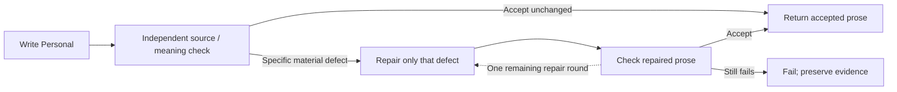

# Personal: stop paying for optional word shuffling

September 19, 2026. Local implementation requested by Tony. No deployment or new paid generation.

## What was missing

The editor could return zero changes, but the application still called and paid it on every Personal report. That did not deliver conditional editing. The latest saved run paid $0.120510 for five replacements; most were wording preferences. Tony found the reading clear and considered its useful astrology references appropriate.

## Current behavior

The existing independent Opus source/meaning reviewer now sees the original Personal draft before any editor. Acceptance returns that prose directly. A repair requires nonempty findings explaining a specific source, meaning, clarity or coherence problem and the reader benefit of fixing it. The reviewer is told not to request synonym swaps, preferred cadence, grade chasing or removal of useful astrology references.

The Personal repair prompt no longer includes the general prose-pattern detector or broad polishing brief. It tells the editor to address only the findings and their immediate implications, preserve unrelated prose verbatim, and explain each replacement's benefit. The existing exact-span, overlap and cumulative revision limits remain. After a repair, both code checks and independent review still run.

This enforces skipping an editor on accepted drafts in code. Whether a finding or proposed repair truly benefits a reader remains a model judgment; we have not added another judge, lexical ban or style quota to try to guarantee that judgment mechanically.

## Boundaries, failure and cost

- Scope: **Personal only**. Life Chapter keeps its existing compulsory editor; Synastry keeps writer plus review.
- Accepted Personal: two paid calls instead of three. One repair: four calls. At most two writer attempts and two edit rounds remain; maximum successful Personal path is seven calls, including the initial review. The source check is not removed or downgraded to an advisory.
- Invalid or inconsistent review output fails closed. A rejection without usable findings cannot trigger editing. Malformed edit JSON can use the existing remaining edit round; unresolved source findings never silently become acceptance.
- Metadata records the reviewer separately and records an editor only if one was called. The optional field is backward compatible with saved results. Usage still totals every actual call.
- Prompt version: `astra-portraits-v4.10-personal-check-first-2026-09`. Inputs, selected evidence, source/private boundaries, models, reasoning settings, existing report records and pricing in Stars are unchanged.

Existing pilot evidence motivated the change but did not qualify the checker as infallible. This implementation preserves that source check; it does not claim the earlier source-precision misses are solved.

## Verification

Luna completed routine validation with mocked provider responses; no paid generation was needed:

- `npm run test:portraits-v4`: passed engine, budget and inspector suites. Accepted Personal dispatches two calls and preserves prose; a source correction dispatches four and changes only the named span. Life Chapter retains three calls. Usage and optional reviewer/editor metadata survive contract parsing.
- Invalid or inconsistent initial reviews stop at two calls without editing. A malformed edit can recover within the existing bound; two malformed edits stop at four calls. A malformed post-repair review stops at four with no delivered sections. Persistent rejection stops at six calls. Advisory wording alone does not trigger editing.
- Focused ESLint, `npm run typecheck`, `npm run test:synastry-v3-engine` and `npm run build`: passed. The affected Portraits suite, focused lint and typecheck passed again after the final test-only additions.
- `git diff --check`: passed. The inherited Synastry V3.3 evaluation edit was preserved unchanged.

No rendered browser verification was performed: the affected behavior is provider dispatch, and existing authenticated report fixtures require database writes outside this task. No routes or layouts changed. Global lint was not rerun; existing experiment-runner errors remain separate from the passing focused lint.

## Actual-diff review

**Steward judgment: accept-with-notes.** Reviewed the changed control flow, prompts, metadata contract, regression evidence and documentation. Personal moves its existing review before conditional repair; it adds no judge or model dependency. Exact-span limits, independent post-repair checks, private trace and actual-call accounting remain. The new optional metadata field preserves historical compatibility. The verification playbook now tests dispatched calls rather than treating permission for zero edits as savings.

The tests establish control flow and failure bounds, not live literary quality or perfect source detection. The reviewer still decides whether an issue has a clear reader benefit. Earlier source-precision misses are not claimed solved. No new reusable lesson beyond the updated verification procedure; this implements the already-established editorial decision. No deployment, live database writes, historical report rewrites or new API spend.
