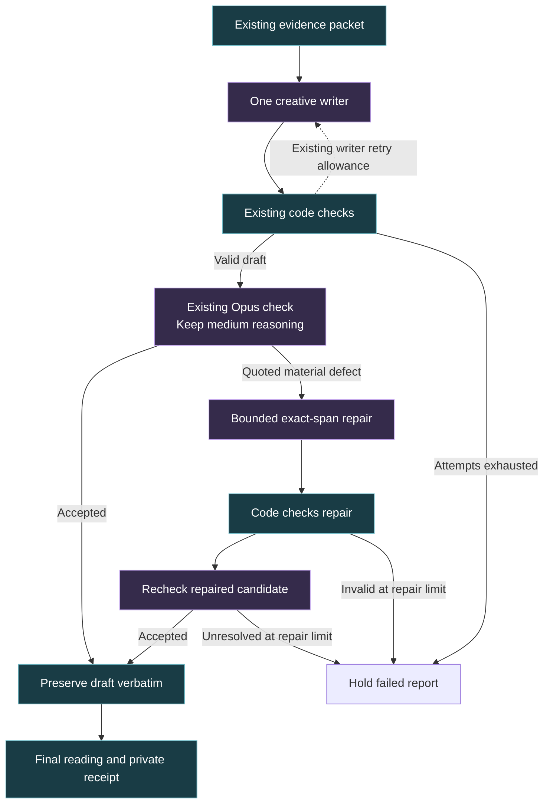

# AstraComposer: improve the reading, reduce the machinery

September 19, 2026. Research and a bounded checker comparison in the existing portraits worktree. **No product code, model defaults or deployment changed during this review.**

Follow-up: [deep research on LLM writing techniques and their limits](LLM_WRITING_RESEARCH_2026_09_19.md), including 2026 work on prompt optimization and semantic error localization.

Subsequent work: [new paired tests and Tony's fewer-style-rules standard](REPORT_SIMPLIFICATION_TESTS_2026_09_19.md). Those tests support removing the hard paragraph-start quota as the smallest next application change. The earlier checker comparison and its costs below remain unchanged historical evidence.

## Decision

**Make accepted Personal and Life Chapter drafts bypass the editor.** Run the existing acceptance check first; use the existing exact-span editor only when that check identifies a material defect. Preserve accepted prose verbatim. Keep the current checker model and reasoning setting for this first comparison.

This is the next recommended simplification, not an implemented or qualified change. It removes a compulsory paid pass without discarding the capacity to repair a wrong source relationship. The current implementation is documented in [the report-writing flow](../architecture/REPORT_WRITING_FLOW.md).

**Do not turn reasoning off across the whole pipeline.** Today's test found a real cost and speed benefit, but also a lost detection. **Do not promote a cheaper general checker yet.** All tested settings allowed the known relationship overclaim through. We have evidence for changing the work allocation, and evidence against a blanket model downgrade.

Tony should only have to supply the outcome, constraints and budget. Exploring removal, ordinary code, cheaper models, reasoning settings, smaller outputs and better source representation belongs to the engineering job.

## What the saved prose and bills show

These are observed runs, not forecasts. Writer costs include any writer retry. Reading grades come from the actual saved draft and final text; latency is the complete recorded run, not an isolated editor timing.

| Saved run | Writer | Editor | Acceptance check | Total | Run time | Draft → final grade | Editorial result |
| --- | ---: | ---: | ---: | ---: | ---: | --- | --- |
| Personal, latest API cohort | $0.081822 | $0.157475 | $0.043485 | $0.282782 | 141.2 s | 7.7 → 7.7 | Two paragraphs changed: mostly emphasis and phrasing |
| Life Chapter, same cohort | $0.035520 | $0.088275 | $0.050520 | $0.174315 | 77.8 s | 8.1 → 8.1 | One paragraph changed: reassurance removed and a small rephrase |
| Synastry, earlier full editor | $0.100341 | $0.243700 | $0.013146 | $0.357187 | 191.7 s | 9.7 → 8.8 | Nineteen paragraphs changed; material inference problems remained |
| Synastry, completed light editor run | $0.093141 | $0.237360 | $0.012582 | $0.343083 | 172.0 s | 9.8 → 9.8 | **Zero editor prose changes**; three later code substitutions |

The first two editors cost **$0.245750 combined** for three changed paragraphs. Their raw responses reported **6,118 reasoning tokens** out of 6,634 output tokens. The edits do not demonstrate a comparable reader benefit. This amount is the observed spend on the stage proposed for bypass; it is **not guaranteed future savings**, because some drafts will need repair and checking an unedited draft can cost differently.

Earlier experiments did sometimes find a useful Opus style improvement and a substantive source correction. That supports retaining bounded repair. It does not justify editing every acceptable report. The completed Synastry editor removal already follows that subtraction principle; today's review makes no further runtime change.

Private evidence: [complete comparison table and all diffs](../../.astra-exports/portraits-v4/api-wired-2026-09-19T15-30-34.757Z/COMPARISON.md), [light editor review](../../.astra-exports/portraits-v4/synastry-light-2026-09-19T17-50-09.427Z/REVIEW.md), and [earlier creative-editor decision](TC_CA_PLAYFUL_EDITOR_DECISION.md). Private links require this local worktree and are intentionally absent from Git.

## What the small bakeoff established

We compared the **same prompt and evidence for each case** under three settings: Opus 4.8 with medium reasoning, Opus 4.8 with reasoning explicitly disabled, and Haiku 4.5 with reasoning explicitly disabled. The existing V4 review prompt was unchanged. The complete relationship report used its existing Synastry review prompt unchanged. This tests each setting on the current jobs; it does not compare the two prompts causally.

Each setting first had to pass ten saved controls, then checked four complete saved reports. The complete reports included a related incorrect/corrected pair. These are familiar challenge cases with existing independent judgments, not fresh holdouts or fourteen independent samples. Each setting received one attempt per case, with no retries, tuning or resampling. All used the existing private Amazon Bedrock route through OpenRouter; raw receipts confirm the provider. No new report was generated and no paid judge was used.

| Checker setting | Short controls | Complete report decisions | Material errors caught, out of two | Cost for four complete checks | Median complete-check time |
| --- | ---: | ---: | ---: | ---: | ---: |
| Opus 4.8, medium reasoning | 10/10 | 3/4 | 1/2 | $0.211650 | 11.81 s |
| Opus 4.8, reasoning off | 10/10 | 2/4 | 0/2 | $0.136550 | 1.29 s |
| Haiku 4.5, reasoning off | 10/10 | 2/4 | 0/2 | $0.019555 | 1.11 s |

All settings accepted the two acceptable complete reports. Only reasoning-enabled Opus rejected the incorrect Life Chapter for the **right reason**: a paragraph used the sign and house of progressed Mars to explain an aspect involving natal Mars. Both reasoning-off settings correctly rejected the short version of this distinction, then missed it in the complete report. All settings accepted the relationship report despite its known unsupported reciprocity/withdrawal problem.

The comparison cost **$0.666490**, including three route checks and thirty short controls. The recorded project ledger is now **$6.572454** against the original $30 ceiling. All 45 charges settled; no unresolved reservation remains. The frozen additional cap was $1.50. Acquisition is complete.

**Decision: no challenger qualified.** Even the reference setting failed the combined acceptance criterion. The result supports retaining reasoning for the current full V4 source check while simplifying other work. It does not establish a production error rate, a fixed latency advantage, or that no smaller model could ever do a narrower task. There was only one response per setting and case; provider load, model variability and caching can affect timings.

Private evidence: [frozen decision](../../.astra-exports/portraits-v4/checker-bakeoff-2026-09-19/DECISION.md), [results and limits](../../.astra-exports/portraits-v4/checker-bakeoff-2026-09-19/REPORT.md), and [machine-readable outcomes](../../.astra-exports/portraits-v4/checker-bakeoff-2026-09-19/result.json).

## Where reasoning belongs

| Work | Recommended treatment | Evidence or qualification needed |
| --- | --- | --- |
| JSON shape, known source IDs, missing fields, dates, exact duplicates, leakage patterns, counts and grades | Ordinary code; no generative call | Much of this already exists. Improve coverage only where a specific gap is demonstrated. |
| A narrow comparison between one explicit claim and its stated source | Candidate for a small model with reasoning off, only if code cannot decide it | Haiku passed the short controls. It has **not** qualified for a new restricted production role. |
| Whole-report source binding, negation, perspective and ambiguous factual implications | Retain the current reasoning-enabled V4 check for the next ablation | Today's complete source-frame case failed with reasoning off. |
| Prose creation and synthesis | Keep one capable writer | Judge the finished reading and factual boundaries together. No writer-model change was tested today. |
| Stylistic tidying of an already acceptable draft | Omit the call | Latest saved edits provide little demonstrated value; the light Synastry editor made none. |

The existing OpenRouter adapter already supports an explicit `reasoning: { enabled: false }` request. Today's disabled runs reported zero reasoning tokens. Asking for a short answer or omitting visible explanations is not the same control. A model's confidence should not decide whether to escalate: the cheaper settings were confidently wrong on the complete source error.

## The next flow to test

This proposal applies to Personal and Life Chapter. The current Synastry flow remains separately documented; it already has no paid editor.

The ordinary accepted path becomes **two paid calls instead of three**. The diagram omits intermediate retry arrows inside the existing bounded repair allowance. Failure must still produce a held result. No new routing model or extra reviewer is proposed.

For the first ablation, keep the writer, evidence packet, acceptance prompt, model and reasoning setting fixed. Compare saved drafts directly with their edited versions; require fewer paid calls on accepted drafts, preservation of their prose, and continued detection of known material errors. Read complete reports for adult voice, useful progression and loss of insight. Do not declare success from reading grades or mock call counts alone.

## The relationship checker needs a clearer decision

Its current prompt already forbids invented mutual attraction and interpreting withdrawal as hidden interest. Adding that prohibition again would repeat an instruction that is already failing.

The same prompt also asks for representative supportable possibilities, lists of supported and unsupported claims, and a separate severity judgment. In today's complete relationship case, Haiku identified unconfirmed reciprocal desire in its unsupported list and returned severity `none`. Opus without reasoning returned `minor`. Both outcomes pass the current gate. More reasoning did not fix this case either.

**Hypothesis for a subsequent, separate test:** replace the general support inventory and discretionary severity with a short list of material violations, each tied to an exact passage, source relationship and reader consequence. Let code derive acceptance from that list. Keep interpretive possibilities permissible; do not reject every unsupported inference or demand a disclaimer in every sentence. Use paired examples that distinguish an evocative possibility from an assertion of someone's actual response.

This would simplify the decision output, not add another reviewer. It remains untested. Today's responses do not isolate whether prompt framing, coverage, materiality calibration or model capability is the main cause. The known relationship failure remains a qualification blocker regardless of editor savings. The existing unavailable-review fallback also means some reports can complete without a semantic endorsement; such runs must not be counted as reviewed successes.

## Cheaper alternatives worth considering

Published standard text-token prices checked September 19, 2026. These are illustrative list prices, not quotes for the exact private route. The example is 4,000 input plus 300 output tokens, with no cache, extra reasoning, retries or other charges.

| Model | Input / output per million tokens | Example check | What is established here |
| --- | --- | ---: | --- |
| Haiku 4.5 | $1 / $5 | $0.005500 | Existing private route tested; cheap short checks worked, complete-report gate replacement failed. [Anthropic pricing](https://www.anthropic.com/claude/haiku) |
| GPT-5.4 nano | $0.20 / $1.25 | $0.001175 | Officially aimed at tasks including classification and extraction; no Astra quality or private-route qualification in this review. [OpenAI model documentation](https://developers.openai.com/api/docs/models/gpt-5.4-nano) |
| Gemini 3.1 Flash-Lite | $0.25 / $1.50 | $0.001450 | Published option for high-volume simple processing; no Astra quality or private-route qualification in this review. [Google pricing](https://ai.google.dev/gemini-api/docs/pricing#gemini-3.1-flash-lite) |

Haiku is the least disruptive candidate for a **future narrower checker experiment** because the existing route was exercised. The cheaper published models could justify a later comparison after the task is made precise. There is no evidence here to select either for production. Paid-tier data-use statements do not by themselves establish the same retention and routing controls as the current private route. No confidential report was sent to a new provider.

## Better prompts, linguistics and semantic tools

### Teach the reading we want

Use a compact positive brief and a few contrasting examples: an effective paragraph to leave alone, a genuinely confusing passage and its useful repair, and a vivid interpretation that stays within the evidence. Examples should preserve adult register and allow different sentence and paragraph shapes. Retire redundant rules after testing their removal. Anthropic's context-engineering guidance favors concise, high-signal context and representative examples over accumulating every edge case. This is prompting guidance, not proof of an Astra quality improvement. [Anthropic research](https://www.anthropic.com/engineering/effective-context-engineering-for-ai-agents)

The present writer already includes idea ownership and practical Life Chapter guidance. Adding those slogans again will not teach the missing distinction. Test whether examples improve what those instructions actually produce.

### Measure progression and clarity beyond reading grade

A lower grade can come from chopping sentences while leaving the same abstract argument repeated across chapters. Evaluate whether each chapter adds an observation or consequence, whether references remain clear, and whether the ending advances or completes the reading. Preserve variation in rhythm. Use grade as a diagnostic beside these judgments.

Pitler and Nenkova found that vocabulary and discourse features mattered to adult readers' quality judgments; simple surface measures were incomplete. Their study concerned news text, so its direct accuracy figures do not transfer to Astra. The applicable lesson is to evaluate connected meaning and audience fit alongside sentence length. [Readability study](https://aclanthology.org/D08-1020/)

### Make source relationships easier to verify

The demonstrated Life Chapter error involved binding correct pieces of evidence to the wrong entity. Representing an aspect with explicit participant IDs and natal/progressed frames can prevent accidental source conflation and support deterministic validation of structured claims. An ordinary typed record is sufficient; a graph database or fresh retrieval system is not required for that job.

Checking that IDs exist does not prove that prose accurately uses them. Extracting every claim from unrestricted prose is itself fallible, so this proposal must retain semantic review until source-binding coverage is demonstrated. Today's evidence does not show a faulty ephemeris or establish a need for more external sourcing.

### Use semantic tools for a bounded question

| Tool family | Useful role | Limit |
| --- | --- | --- |
| Exact rules and token/dependency matching | Find explicit source names, dates, reference leaks or candidate claim spans | Linguistic extraction can miss context; matches are not automatic rewriting instructions. [spaCy documentation](https://spacy.io/usage/rule-based-matching) |
| Sentence embeddings | Flag possible repeated ideas for offline inspection | Similarity does not establish factual support or distinguish a useful return to a theme from redundancy. [Sentence Transformers documentation](https://www.sbert.net/docs/sentence_transformer/usage/semantic_textual_similarity.html) |
| Natural-language inference | Compare a specific factual proposition with the relevant source sentence | Domain qualification is necessary; symbolic psychological interpretation is not ordinary factual entailment. [SummaC research](https://aclanthology.org/2022.tacl-1.10/) |

SummaC's relevant finding is that sentence/document granularity affected consistency detection. The Astra inference is to compare explicit claims with the correct source relationship, rather than treating broad thematic similarity as support. None of these tools was installed or added to runtime. Start with existing code and offline diagnostics; adopt a dependency only if it beats that baseline on a defined failure.

## Other cost opportunities, after the first ablation

The Synastry writer still emits four descriptive support fields for every paragraph. In one saved light-editor writer response, visible prose was 7,679 characters and the support block was 18,108: **70.2% of their combined characters were private trace**. This is a character measurement, not a token or savings percentage. The semantic reviewer receives prose and source evidence, not those four generated explanations. They are useful audit material, but are not independent corroboration.

A later compact paragraph-to-source trace experiment could reduce output length while preserving auditability. Validate any effect on prose quality, source checks and historical trace readers. The earlier truncation failure makes output-budget reduction worth testing; simply lowering the maximum risks repeating that failure.

Stable prompt prefixes may allow caching where the actual provider supports it. Batch work belongs in offline experiments, not interactive report delivery. Parallel calls help only when independent; an editor and a reviewer of its result are dependent. OpenAI's latency guidance supports reducing unnecessary requests and output and using classical methods where suitable. No cache savings were measured here. [Official latency guidance](https://developers.openai.com/api/docs/guides/latency-optimization)

The remaining automatic voice substitutions also deserve a subtraction test: the light Synastry run changed three phrases after the editor preserved the prose. Those substitutions were not shown to improve reader understanding. Treat this as a separate small ablation, preserving structural parsing and leakage checks.

## How the work can improve cumulatively

Saved outputs and versioned prompts preserve history. They do not train model weights or automatically select a better configuration. The missing capability is a stable evaluation and promotion loop with feedback independent of the candidate's own explanation.

1. Keep a small owned set of whole-report decisions and preferred/unchanged passages. Record the decisive error or reader benefit, including cases where good prose must remain untouched. Split by person/report family so a repaired report is not treated as an independent holdout.
2. Freeze the current candidate, comparator, data split, objective and budget before each run. Change one cause at a time: editor bypass, prompt, reasoning, model, or trace format.
3. Use material false accepts and false rejects as constraints. Compare complete-reading preference, unnecessary edits, actual paid cost, latency and failures separately. Do not blend them into a score that can reward cheap but incorrect output.
4. Preserve every result, including losses. Promote only when the candidate clears the agreed cases and a fresh held-out check. Reusing today's failures to tune a prompt turns them into development examples, not fresh validation.
5. Automate deterministic replay, metrics and comparison receipts. Use human judgment for disputed meaning and reading preference. Bring a model in only when there is a substantive decision or candidate change to investigate.

DSPy demonstrates optimizing prompts and demonstrations against a specified metric; it does not supply the right metric or independent truth. Such optimization could become useful offline after the acceptance examples stabilize. Installing it now would add machinery before resolving the grading weakness. Actual fine-tuning or distillation likewise needs enough approved examples, evidence that prompting has plateaued, and a volume-based cost case. [DSPy paper](https://arxiv.org/abs/2310.03714)

## Reusable instruction for future work

> Own the quality, cost and latency tradeoffs. Proactively test what can be removed, handled by ordinary code, or done by a cheaper model with reasoning off. Challenge prompts, context, output length and dependencies. Use saved evidence and small controlled comparisons within my budget. Preserve good prose and material source checks. Recommend the simplest approach supported by the results, including failed alternatives and uncertainty. Do not wait for me to suggest the directions. Keep implementation and deployment within the scope I authorize.

## Review receipt

Research judgment: **accept with notes**. The proposed removal of compulsory editing is supported for a controlled next ablation. No checker replacement or global reasoning change qualified. The relationship gate's false accept remains unresolved. Product quality is not declared solved.

Verified frozen prompt, source, runner and decision hashes; checked all 45 provider receipts, explicit reasoning-off requests, accounting and material rejection rationale. Product source hashes were unchanged. The inherited uncommitted `SYNASTRY_API_EDITOR_V3_3.md` remains owned by prior evaluation work and was avoided. `ak doctor` and `ak dirty` were read; existing governance metadata findings are unrelated to this documentation study and were not changed. No product tests, browser run or rebuild was needed because the application was not modified.

Next bounded outcome: demonstrate that accepted Personal and Life Chapter drafts can skip editing without losing their prose or the existing material source check. Keep other settings fixed and report any repair that still earns its cost.
